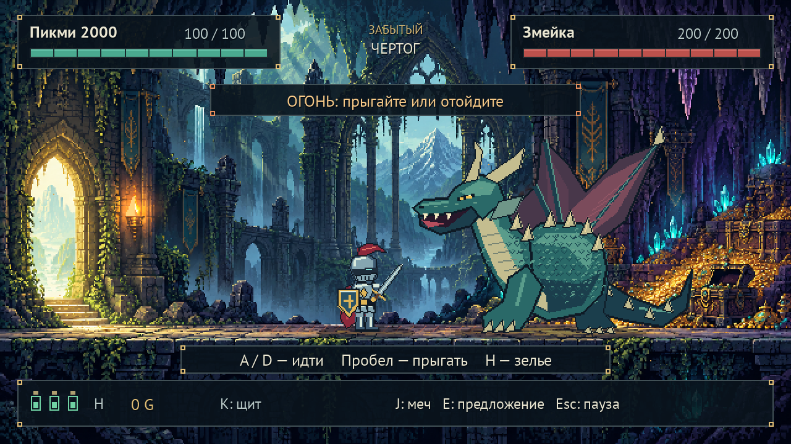

# Рыцарь и Дракон

Учебный проект по объектно-ориентированному программированию на Python.

Изначально я самостоятельно написал консольную игру «Рыцарь и Дракон». Затем на основе её механик была создана дополнительная графическая версия на Pygame с помощью Codex.

**Первоначальный файл `knight and dragon.py` сохранён без изменений.**



## Две версии игры

### Консольная — первоначальная работа

Пошаговая игра с классами `Character`, `Knight`, `Dragon` и `Game`.

Рыцарь может атаковать, защищаться щитом, использовать зелья, сделать предложение дракону или сбежать.

Исходный код находится в файле `knight and dragon.py`.

### Графическая — дополнительная версия

Игра с видом сбоку, пиксельной графикой и боем в реальном времени.

В ней есть:

- движение, прыжки и удары мечом;
- щит и лечебные зелья;
- дракон с атаками когтями, огнём и легендарным «МЯУ»;
- анимации, музыка и звуковые эффекты;
- меню, пауза и возможность начать заново;
- четыре концовки с отдельными кат-сценами.

## Как запустить

Готовая сборка предназначена для **Windows 11 x64**.

1. Скачайте репозиторий: **Code → Download ZIP**.
2. Распакуйте архив целиком.
3. Запустите нужный файл:

| Файл | Что запускает |
|---|---|
| `START_ORIGINAL.bat` | Первоначальную консольную игру |
| `START_GAME.bat` | Графическую версию |

Python и необходимые библиотеки включены в готовую сборку. Для запуска устанавливать или скачивать зависимости не требуется.

Сохраняйте структуру папок: исполняемым файлам нужны библиотеки, расположенные рядом с ними.

## Управление графической версией

| Клавиша | Действие |
|---|---|
| A / D или стрелки | Двигаться |
| Пробел | Прыгать |
| J | Атаковать мечом |
| K | Поднять щит |
| H | Выпить лечебное зелье |
| E | Сделать предложение рядом с драконом |
| Esc | Пауза |
| M | Включить или выключить звук |
| F11 | Полноэкранный режим |

Чтобы сбежать, двигайтесь к выходу в левой части пещеры.

## Характеристики

- Рыцарь: **100 здоровья**, меч наносит **25 урона**.
- Дракон: **200 здоровья**.
- Когти дракона: **10–25 урона**.
- Огонь дракона: **10–45 урона**.
- Рыцарь имеет **3 зелья**, каждое восстанавливает до **30 здоровья**.
- Щит уменьшает следующий полученный урон вдвое.
- Награда за победу: **500 золота**.

## Концовки

1. **УБИЙЦА ДРАКОНА** — победить дракона.
2. **ПИКМИ НЕ ВЫЖИЛ** — проиграть сражение.
3. **ЛЮБОВЬ ПОБЕДИЛА** — сделать предложение дракону.
4. **ТРУСЛИВЫЙ ПИКМИ** — сбежать из пещеры.

## Структура проекта

```text
knight and dragon.py   — неизменённая первоначальная работа
START_ORIGINAL.bat     — запуск консольной версии
START_GAME.bat         — запуск графической версии
ConsoleOriginal/      — готовая консольная сборка
Game/                 — готовая графическая сборка
source/               — исходники обеих версий
screenshots/          — скриншоты
licenses/             — лицензии используемых компонентов
```

Подробная инструкция по запуску исходников и архитектуре графической версии находится в `source/pixel_knight_dragon/README.md`.

## Технологии

- Python
- Pygame
- Объектно-ориентированное программирование
- PNG-атласы покадровых анимаций
- Локальные звуковые ресурсы
- PyInstaller для автономных Windows-сборок
